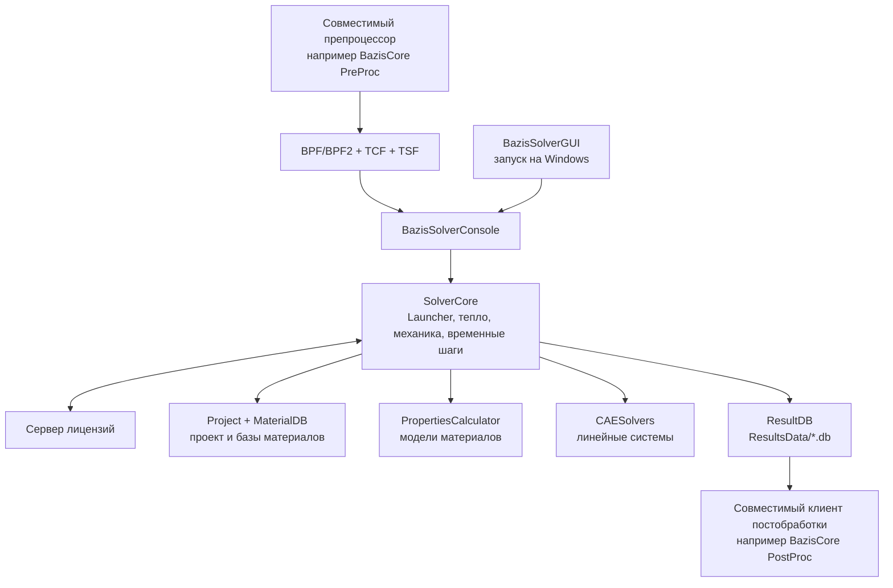

# BazisSolver

[Скачать релиз](https://github.com/BAZIS-SOFTWARE/Bazis-Solver/releases)

## Назначение и возможности

BazisSolver — решение на C# для численного расчёта задач математической физики методом конечных элементов. Оно получает сетку и условия из проекта BPF/BPF2, читает очередь расчётов TCF и параметры задач TSF, выполняет расчёт и сохраняет результаты. Входной комплект может подготовить BazisCore PreProc или другой препроцессор, создающий совместимые файлы. Результаты предназначены для анализа инженером и чтения совместимым клиентом постобработки. Источники: контракт проекта и очереди, запуск расчётов, задачи решения.

Основные возможности:

- **Тепловой расчёт:** нестационарная теплопроводность, источники и теплообмен; доступны 3D, плоская 2D и осесимметричная 2D ветки. Тепловая задача может использовать заданную скорость или скорость из файла результатов. См. HeatTask.
- **Механический расчёт:** нагрузки, закрепления, температурное воздействие, перемещения, реакции, напряжения и деформации. В механической задаче используются пластическое упрочнение и температура из значений либо результатов теплового расчёта. См. MechTaskM.
- **Последовательные и связанные расчёты:** TCF задаёт порядок задач; начальное состояние можно восстановить из предыдущего результата, а внешние поля интерполировать по времени. См. чтение очереди, загрузку состояния и внешние поля.
- **Модели материалов:** `PropertiesCalculator` содержит модели упрочнения, ползучести, фазовых превращений, твёрдости и размера зерна. В текущем пути SOLVER используются упрочнение и фазовые превращения; ползучесть, твёрдость и размер зерна пока не включены в расчётные результаты. См. каталог функций.
- **Результаты:** временные слои узловых и элементных величин сохраняются в базу результатов с таблицами `nodes` и `elements`; для каждой задачи ведётся журнал. См. сохранение результатов и расчётный цикл.
- **Лицензирование:** право использования программы определяется лицензионным соглашением. Перед каждой физической задачей SOLVER запрашивает у сервера разрешение на соответствующий модуль и сверяет число элементов модели с разрешённым лимитом. Если сервер недоступен или отказал, задача может выполняться в демо-режиме при размере модели не более 30 000 элементов. См. Launcher.

Исполняемый путь сейчас охватывает тепловую и механическую задачи. `ChemTask.cs` исключён из сборки, отдельного гидродинамического решателя нет; получение скорости из внешнего результата не является расчётом течения. Подробности: бизнес-задачи, функции и ограничения, реализация.

## Компоненты решения

Стрелка на схеме означает передачу данных или использование компонента. Препроцессор, клиент постобработки и сервер лицензий могут быть внешними приложениями.



| Компонент | Роль |
| --- | --- |
| BazisSolverConsole | Консольная точка входа, принимающая путь к TCF |
| SolverCore | Загрузка задач, физические элементы, сборка систем, временные шаги и сохранение результатов |
| PropertiesCalculator | Модели поведения материала и вычисление свойств |
| BazisSolverGUI | Небольшой графический запускатель консольного SOLVER для Windows |

Состав решения указан в SolverSolution.sln. `Project`, `MaterialDB`, `ResultDB`, `CAESolvers` и клиент лицензирования подключены как пакетные зависимости SolverCore. `MaterialDB 1.0.9` подключён напрямую: эта версия позволяет загружать файлы баз материалов и функций по путям Windows и Linux. Документация соседнего BazisCore описывает смежные контракты; сборка SOLVER использует указанные в проекте версии пакетов.

## Входные данные и результаты

Типичное размещение файлов проекта:

```text
КаталогПроекта/
  project.bpf2
  ComputationData/
    computation.tcf
  InputData/
    термическая_0_0_0.25.tsf
  ResultsData/
    ...                         # создаётся при расчёте
```

TCF содержит команду загрузки проекта и упорядоченные команды расчёта со статусами `выполнить` или `пропустить`. Пути внутри команд заключаются в двойные кавычки, задаются относительно `ComputationData` и используют `/`. SOLVER читает проект через пакет `Project`, параметры тепловой и механической задач из TSF, а результаты записывает в `ResultsData/*.db`; журналы задач — в `ComputationData/*.log`. См. контракт файлов, Launcher и реализацию сохранения.

### Инструкции TCF и TSF

Пример `ComputationData/computation.tcf`:

```text
загрузить проект "../project.bpf2"
расчет термическая "../InputData/термическая_0_0_0.25.tsf" выполнить
```

TCF задаёт порядок и статус задач; каждый TSF — JSON с параметрами одной физической задачи. Ниже полный пример теплового TSF на основе файла тестового проекта:

```json
{
  "TaskKind": 4,
  "Status": 0,
  "Index": 0,
  "TermalConvergence": {
    "Is_Switched_Tm": true,
    "Tm": 1500.0
  },
  "MetallurgicalProcesses": ["Охлаждение", "Нагрев"],
  "ActiveConditions": [
    "0 Материал Элементы3D_1",
    "1 Среда termo_cycle"
  ],
  "SaveRate": 1,
  "Iterations": 2,
  "SolverSettings": {
    "MaxIter": 100,
    "Solver": "ConjugateGradient",
    "MatrixStorage": "SymmetricCsr",
    "Relaxation": 1.05,
    "Precision": 0.01,
    "Priority": "Наивысший"
  },
  "TimeSettings": {
    "MaxTimeStep": 100.0,
    "MinTimeStep": 0.00001,
    "StartTime": 0.0,
    "StopTime": 0.25,
    "InitTimeStep": 0.25
  },
  "InputSets": [],
  "InitialSet": {
    "Name": "Thermal",
    "Source": "Values",
    "Values": {
      "Элементы3D_1": [
        { "Name": "Temperature", "Components": [20.0] }
      ]
    },
    "File": ""
  }
}
```

`ActiveConditions` ссылается на условия и группы загруженного проекта; имена должны совпадать с проектом. `InitialSet` задаёт начальную температуру по группе элементов, а `InputSets` — внешние физические поля. В имени TSF указаны вид задачи, индекс и границы времени; время в имени и `TimeSettings` должно соответствовать расчётному этапу. Для механической задачи применяется другой набор параметров и, в текущем пути SOLVER, требуется входной термический набор. См. пример механического TSF, Launcher и MechTaskM.

### Формат результатов

Для каждой задачи создаётся файл `ResultsData/<вид>_<индекс>_<начало>_<конец>.db`, например `термическая_0_0_0.25.db`. База SQLite содержит таблицы `nodes` и `elements`. Каждая строка описывает один узел или элемент на одном временном слое: `Time` — время слоя, `Индекс` — номер узла в `nodes` или элемента в `elements`, `Id` — служебный ключ записи. Поэтому один и тот же `Индекс` встречается при разных значениях `Time`. Начальное состояние записывается отдельно, затем сохраняются принятые шаги согласно `SaveRate`, а конечный шаг — всегда. См. имя файла и сохранение, цикл шагов, [схему сохранителя ResultDB](https://github.com/BAZIS-SOFTWARE/Bazis-Core/blob/Master_dev/ResultDataBase/IO/SaveResultsFileDb.cs).

| Задача | `nodes`: по узлам | `elements`: по элементам |
| --- | --- | --- |
| Тепловая | `T` — температура, `Q` — узловое значение вектора тепловой нагрузки | `T` — температура элемента, `Q` — усреднённое по его узлам значение нагрузки, `V` — скорость нагрева/охлаждения, столбцы долей фаз по их именам |
| Механическая | `X/Y/Z` — компоненты перемещения, `Rx/Ry/Rz` — реакции; в 2D используются `X/Y` и `Rx/Ry` | `T`, компоненты деформаций `Ex/Ey/Ez/...`, напряжений `Sx/Sy/Sz/...`, эквивалентные величины `Emis/Smis`, пластическая деформация `Ep`, фазовый состав и другие показатели материала |

Состав столбцов зависит от постановки и размерности. В механической таблице `nodes` названия `X/Y/Z` означают **перемещения**, а не координаты узлов. Некоторые столбцы присутствуют в схеме с нулевым значением по умолчанию, хотя конкретный путь расчёта их не заполняет; для анализа следует ориентироваться на реально записываемые величины. Источники: тепловые таблицы, механические таблицы 3D, механический результат.

Например, из теплового файла можно выбрать температуру узла и элемента с номером `1` по времени:

```sql
SELECT Time, T FROM nodes WHERE "Индекс" = 1 ORDER BY Time;
SELECT Time, T, V FROM elements WHERE "Индекс" = 1 ORDER BY Time;
```

## Сборка и запуск

Консольный проект рассчитан на .NET 8. Для сборки нужен .NET SDK 8 и доступ к пакетным зависимостям, указанным в файлах проектов. Windows GUI использует Windows Forms; консоль и тесты собираются на Windows и Linux. Для одновременной работы на двух ОС используйте отдельные копии репозитория или раздельные каталоги `bin` и `obj`, чтобы сборки не перезаписывали промежуточные файлы друг друга. См. консольный проект и проект GUI.

Из корня репозитория:

```text
dotnet build BazisSolverConsole/BazisSolverConsole.csproj
dotnet run --project BazisSolverConsole/BazisSolverConsole.csproj -- "путь/к/ComputationData/computation.tcf"
dotnet test TestSolverCore/TestSolverCore.csproj
```

Для сборки Linux в WSL Ubuntu из Linux-копии репозитория:

```text
dotnet build BazisSolverConsole/BazisSolverConsole.csproj -c Debug-Linux
dotnet test TestSolverCore/TestSolverCore.csproj
```

Сборка `Debug-Linux` создаёт исполняемые файлы в `BazisSolverConsole/bin/Linux/Debug/net8.0/linux-x64/`. Путь к TCF передаётся первым аргументом консоли. Для запуска нужен совместимый входной комплект; при недоступном сервере лицензий действуют условия демо-режима. Launcher определяет режим перед выполнением каждой задачи. Проверочные сценарии находятся в TestsTermalTask.cs, TestsMechTask.cs, TestsMetallurgicalTask.cs и тестах моделей материалов. Интеграционные тесты записывают результаты в `TestSolverCore/ExampleProj`, поэтому удобнее запускать их в отдельной рабочей копии. В последней проверке полного `TestSolverCore` на Windows и WSL прошли 134 теста; два сценария с работающим сервером лицензий были пропущены.

### Запуск готовой сборки

Релиз содержит два самодостаточных архива: `BazisSolver-<версия>-Release-x64.zip` для Windows и `BazisSolver-<версия>-Release-Linux-x64.tar.gz` для Linux. После распаковки архивов установленные .NET SDK и .NET Runtime не требуются. Переносите весь каталог сборки, включая соседние DLL, файлы `.deps.json`, `.runtimeconfig.json` и каталог `runtimes`. Используйте архив для соответствующей ОС.

Примеры ниже относятся к локальным сборкам `Release|x64` для Windows и `Release-Linux|x64` для Linux. Для них на целевой ОС может потребоваться **.NET 8 Runtime**.

Windows, PowerShell (сборка `Release|x64`):

```powershell
& "C:\BazisSolver\BazisSolverConsole\bin\x64\Release\net8.0\BazisSolverConsole.exe" "C:\Data\MyProject\ComputationData\computation.tcf"
```

Linux или WSL Ubuntu (сборка `Release-Linux|x64`):

```bash
dotnet /home/user/BazisSolver/BazisSolverConsole/bin/Linux/Release/net8.0/linux-x64/BazisSolverConsole.dll /home/user/MyProject/ComputationData/computation.tcf
```

Из каталога готовой Linux-сборки можно запустить и исполняемый файл без команды `dotnet`:

```bash
./BazisSolverConsole /home/user/MyProject/ComputationData/computation.tcf
```

Оба варианта требуют установленного .NET 8 Runtime и остальных файлов сборки. Если исполняемый файл не запускается из-за отсутствия права на выполнение, назначьте его командой `chmod +x BazisSolverConsole`.

Замените пути на расположение сборки и вашего проекта. Передавайте абсолютный путь к `computation.tcf`: так команда работает из любого текущего каталога, а пути внутри TCF по-прежнему разрешаются относительно `ComputationData`. При запуске из WSL используйте Linux-путь (`/home/...` или `/mnt/c/...`), а не путь вида `C:\...`. Конфигурация сервера лицензий читается из папки документов пользователя той ОС, в которой запущена программа.

## Лицензия на программу

В лицензионном соглашении для программы «BazisSolver (MAGLA). Инженерный анализ физических процессов» указана простая (неисключительная) непередаваемая лицензия. Некоммерческое использование на условиях соглашения разрешено безвозмездно. Коммерческое использование программы и полученных с её помощью выходных данных требует письменного согласия правообладателя (пп. 1.1, 1.2 и 2.1).

По п. 2.7 соглашения число элементов загружаемой сеточной модели в отдельном расчёте ограничено; увеличение лимита требует отдельного соглашения. Запрета на сохранение результатов в действующей редакции этого пункта нет. Технический предел демо-режима SOLVER — 30 000 элементов включительно.

## Сервер лицензий

SOLVER ищет `ConfigServer.json` в папке документов пользователя (`Environment.SpecialFolder.MyDocuments`) на Windows и Linux. Отсутствующий каталог документов создаётся через `SpecialFolderOption.Create`; если путь к нему не определён, возникает ошибка конфигурации. На Linux в .NET 8 путь берётся из `XDG_DOCUMENTS_DIR`, если он задан, иначе из `$HOME/Documents` ([документация Microsoft](https://learn.microsoft.com/en-us/dotnet/core/compatibility/core-libraries/8.0/getfolderpath-unix)). В WSL при подмене `HOME` для тестов файл создаётся в соответствующем изолированном каталоге. Файл содержит один адрес сервера с обязательным портом:

```json
{"endpoint":"192.0.2.10:8001"}
```

Допустимы IPv4 и IPv6 в квадратных скобках, например `[2001:db8::10]:8001`; порт — от 1 до 65535. При отсутствии файла SOLVER создаёт `ConfigServer.json` с адресом `127.0.0.1:8001` и пытается подключиться к нему. Некорректный существующий файл или ошибка создания вызывают ошибку конфигурации. Перед каждой выполняемой задачей SOLVER запрашивает модуль соответствующей физики. Ответ `можно <лимит>` разрешает расчёт по серверной лицензии, если лимит **строго больше** общего числа элементов загруженной модели; при равенстве или превышении серверного лимита задача не запускается. Если сервер недоступен или ответил отказом, SOLVER запускает задачу в демо-режиме при числе элементов **не более 30 000**. Для модели большего размера задача не запускается. В демо-режиме результаты сохраняются в обычном формате; сообщений `Работа` и `Отдать` серверу нет. Переключение режима происходит только перед запуском задачи. При расчёте по серверной лицензии SOLVER периодически подтверждает работу и после завершения освобождает модуль. Источники: правила настройки, чтение конфигурации, обращения к серверу, тесты выбора режима.
